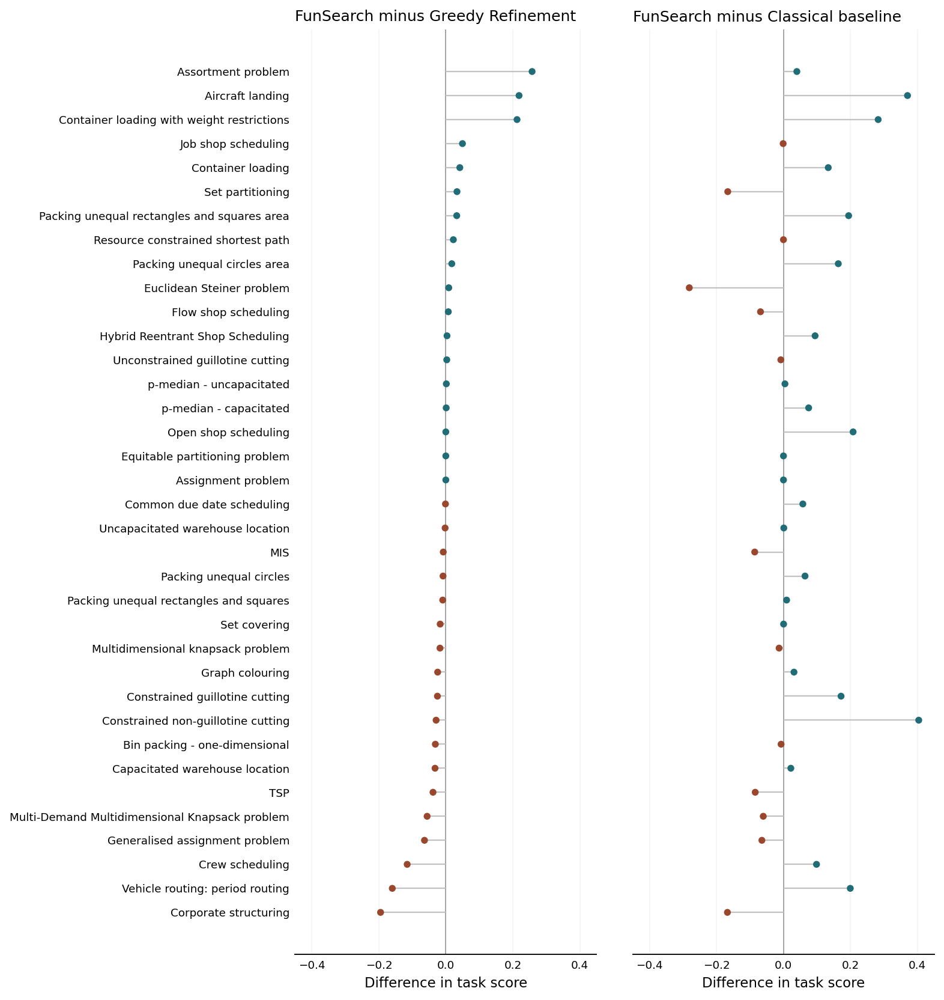

# Reconstructing the leaderboard

The appendix supports two different readings of the headline. FunSearch's 0.842 is reproducible and its advantage over the published classical baseline survives omitting any one task. Its margin over Greedy Refinement is much narrower and sensitive to which tasks receive weight. EoH's reported near-tie with both agents cannot be recovered by averaging the printed EoH rows.

We extracted the numerical strings from Tables 3–38 in both August preprints, preserving decimals and task order. Each edition contains the same 288 task–method cells. We cross-checked all cells against the independent extraction in lace-audit. The aggregate targets below were transcribed from the proceedings figure, including its spellings “Greedy Refine” and “MSTC-AHD.” The appendix uses “Refine” and “MCTS.” Chain-of-Experts and one-shot models have no columns in these 36 tables. [Published Figure 3, p. 33130](https://ojs.aaai.org/index.php/AAAI/article/download/40596/44557) · [August appendix](https://arxiv.org/html/2504.04310v3#A1) · [Extracted values](../evidence/appendix-scores.csv) · [Calculation](../scripts/appendix.py)

| Method | Figure 3 mean | Mean of 36 appendix scores | Tasks strictly above / tied / below classical | Figure 3 “Above Classical” |
|---|---:|---:|---:|---:|
| Classical baseline | .797 | .797275 | — | — |
| BestOfN | .774 | .774377 | 12 / 3 / 21 | .417 |
| Greedy Refinement | .840 | .840106 | 23 / 2 / 11 | .694 |
| FunSearch | .842 | .842286 | 21 / 2 / 13 | .639 |
| AIDE | .753 | .753431 | 8 / 2 / 26 | .278 |
| ReEvo | .774 | .774136 | 15 / 1 / 20 | .444 |
| MCTS-AHD | .762 | .762672 | 14 / 2 / 20 | .444 |
| EoH | .840 | .800679 | 17 / 2 / 17 | .555 |

**EoH.** The gap is 0.039321. Using the appendix moves EoH from roughly level with Greedy Refinement to just 0.003404 above the classical baseline. The project leaderboard also prints .840. A different run, aggregation or transcription could explain the gap. None of these alternatives can be distinguished from the two aggregates. MCTS-AHD's .762672 would conventionally round to .763. Its sub-.001 discrepancy could be accounted for by truncation. [Proceedings Figure 3](https://ojs.aaai.org/index.php/AAAI/article/download/40596/44557) · [Project leaderboard](https://sunnweiwei.github.io/co-bench/) · [Computed means](../evidence/figure3-reconciliation.csv)

**What counts as outperforming classical?** The metric definition describes the fraction of problems with a better score. The caption and the main-results prose refer to test *instances*. Under the problem-level interpretation, 21/36 (.5833) appendix scores are strictly higher for FunSearch. Counting its two ties yields 23/36 (.6389), matching .639. Counting ties likewise accounts for the displayed BestOfN, Greedy Refinement, AIDE, ReEvo and MCTS-AHD proportions to their reported precision. EoH wins or ties on 19/36 (.5278), still short of .555. A tolerance of 1e-9 does not change any strict-win count. This numerical pattern points to an inclusive comparison for six methods. The aggregation script or instance outcomes would be needed to authenticate the rule and support an instance-level claim. [Metric definitions and Figure 3](https://arxiv.org/html/2504.04310v3#Sx3) · [Strict counts and ties](../evidence/figure3-reconciliation.csv)

**A score above one.** Equation (6) bounds every defined finite score by one, so averaging such scores also yields at most one. Fourteen task–method means exceed 1.000001, spanning five tasks. The largest is FunSearch's 1.083901 on packing unequal rectangles and squares by area. This cannot be explained by rounding the stated equation. Several public configurations instead use directional ratios against reference values. A newly improved feasible solution can then deserve a score above one. A reproducer needs the exact reference, objective direction and actual function for each row. [Equation (6)](https://arxiv.org/html/2504.04310v3#Sx3) · [Rectangle-packing table](https://arxiv.org/html/2504.04310v3#A1.T29) · [Task configuration audit](evaluation.md)

## What survives changing the task mix?

FunSearch outscored Greedy Refinement on 15 tasks, tied on three and trailed on 18. Its mean paired difference was +0.002180 and its median was −0.000540. Recomputing the mean after dropping each task in turn changed the sign in three of 36 cases. Omitting aircraft landing gives −0.004002, assortment −0.005115, and container loading with weight restrictions −0.003831. Across all omissions the range was −0.005115 to +0.007810. This measures sensitivity to the benchmark composition. Variation across independent searches is a different quantity, for which the tables supply no samples. [Paired calculations for all omissions](../evidence/leave-one-task-out.csv)

The comparison against the published classical solver is stronger. FunSearch's full-suite margin was +0.045011 and every single-task omission left a positive margin, ranging from +0.034759 to +0.054330. The classical comparator was built with about 30 minutes per task for selecting and tuning a solver. A win over this particular suite supports a claim about that comparator and deadline. Superiority over the strongest specialist on each problem would need further matched experiments. [Classical baseline construction](https://arxiv.org/html/2504.04310v3#Sx3) · [Leave-one-task-out results](../evidence/leave-one-task-out.csv)

Removing the six tasks with coincident development and test sets in the *current* public release also leaves FunSearch ahead on the remaining 30 appendix rows. Their means are .814833 for FunSearch, .811195 for Greedy Refinement, .808773 for EoH and .778141 for classical. This sensitivity check removes whole tasks. It cannot establish how the original searches handled the split or what any of them would have found with fresh, unseen cases. [Split evidence](evaluation.md) · [Thirty-task calculations](../evidence/figure3-reconciliation.csv)

**Selection and uncertainty.** The development metric selects a single program after adaptive search. Variation arises both from the model's proposals during search and from deployment of a stochastic finalist. Running a winning program many times estimates only the latter. The appendix provides one scalar per task and method, without a linked set of discovery replicates or per-instance outcomes from which to estimate either component. The 36 tasks are a deliberately selected suite, so a confidence interval formed by treating thousands of instances as independent search runs would address the wrong question. Figure 5 tracks performance across candidate steps. It is informative about a search trajectory at the chosen deployment limit. [Paper Figures 5–6](https://arxiv.org/html/2504.04310v3#Sx4) · [Replication design](replication-protocol.md)
